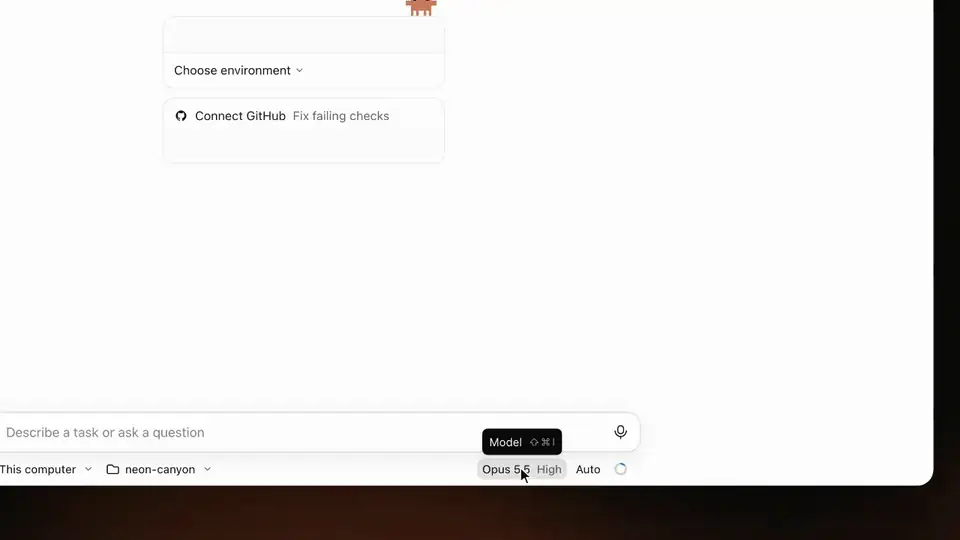

<p align="center">
  <a href="https://vos.so/docs/record/record-a-desktop-app">
    <picture>
      <source media="(prefers-color-scheme: dark)" srcset="https://raw.githubusercontent.com/vosjs/driver/main/.github/assets/lockup-dark.svg">
      
    </picture>
  </a>
</p>

<h3 align="center">Record a Mac app's window, without the pointer.</h3>

<p align="center">
  A headless macOS helper behind a small typed API. One window, the system pointer<br>
  left out of the pixels, and its path written beside the video.
</p>

<p align="center">
  <a href="https://vos.so/docs/record/record-a-desktop-app">Guide</a>
  &nbsp;·&nbsp;
  <a href="https://github.com/vosjs/driver/blob/main/docs/api.md">Reference</a>
  &nbsp;·&nbsp;
  <a href="https://github.com/vosjs/vos">Engine</a>
  &nbsp;·&nbsp;
  <a href="https://vos.so">vos.so</a>
</p>

<p align="center">
  <a href="https://www.npmjs.com/package/@vosjs/driver"></a>
  
  <a href="https://github.com/vosjs/driver/blob/main/LICENSE"></a>
</p>

<br>

<a href="https://vos.so/vos/one-prompt-one-playable-game-neon-canyon-mwg487w3">
  
</a>

<p align="center"><sub>One film across three Mac apps: Claude, Terminal and Chrome, each window recorded on its own by vos driver. <a href="https://vos.so/vos/one-prompt-one-playable-game-neon-canyon-mwg487w3">Watch it with sound</a>.</sub></p>

<br>

## Install

```bash
npm i @vosjs/driver
```

macOS 14 or later and Node 18 or later. It brings `@vosjs/driver-darwin`, one universal binary for Apple silicon and Intel. Most people meet it through the vos CLI, as `vos record --app`.

## Record a window

```js
import { check, record } from '@vosjs/driver'

const { screenRecording } = await check()
if (!screenRecording) throw new Error('Switch on Screen Recording for the app running this.')

const take = record({ app: 'TextEdit', out: './take' })
await take.ready // the first frame is in the file

// ... use the app ...

const stopped = await take.stop()
```

## Script a take

Find the app's controls through accessibility, then press, type and scroll as a hand would.

```js
import { record, tree } from '@vosjs/driver'

const { elements } = await tree({ app: 'TextEdit' })
// [{ role: 'button', name: 'Save', selector: "button[name='Save']", unique: true, ... }]

const take = record({ app: 'TextEdit', out: './take', drive: true })
await take.ready

await take.send({ do: 'type', selector: 'textarea', text: 'Hello from a script.' })
await take.send({ do: 'click', selector: "button[name='Save']" })

await take.stop()
```

Every answer carries `tStart` and `tEnd` on the take's clock, so each act is placed in the footage. A scripted take moves the machine's real pointer and keyboard, so nobody else can use the machine while it runs.

## What a take is

```
take/
  recording.mp4   H.264, the window at its pixel size, no pointer
  cursor.json     the pointer's path, and the bounds of what was pressed
  meta.json       sizes, scale, duration, the app, light or dark
```

`npx vos plan take` reads it and plans the zooms from the track.

## What it never does

- **Put the system pointer in the picture.**
- **Learn what was typed**, or read what is in a field.
- **Record any app but the one.** Every other window is excluded, including one that opens mid-take.
- **Name a window.** `meta.json` holds the app's name, never a window title.
- **Send anything anywhere.** The helper has no network code.
- **Outlive what started it.**

A mask covers what must not show before a frame is encoded, so it is in no file. The [reference](https://github.com/vosjs/driver/blob/main/docs/api.md#what-it-never-does) says each of these in full.

## Status

Early. The helper is ad-hoc signed, not notarised, so macOS records its permissions against the app that launched it (your terminal, editor or agent). No audio, no webcam, no whole-display capture. The Intel half records real takes in CI but has not run on a physical Intel Mac.

## Learn more

- [Reference](https://github.com/vosjs/driver/blob/main/docs/api.md): every export, `record` option, mask, selector and command, the take's files, permissions and errors
- [Record a desktop app](https://vos.so/docs/record/record-a-desktop-app): the same through `vos record --app`
- [Contributing](https://github.com/vosjs/driver/blob/main/CONTRIBUTING.md): build, test and release
- [Security](https://github.com/vosjs/driver/blob/main/SECURITY.md)

## License

[MIT](https://github.com/vosjs/driver/blob/main/LICENSE)
